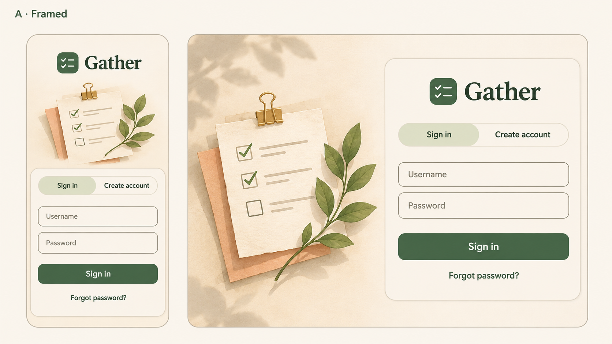
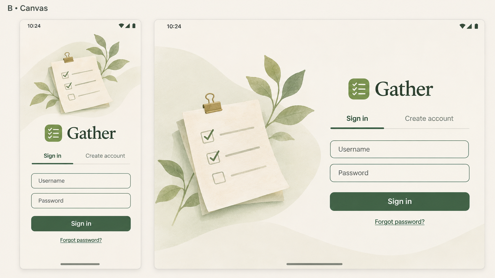
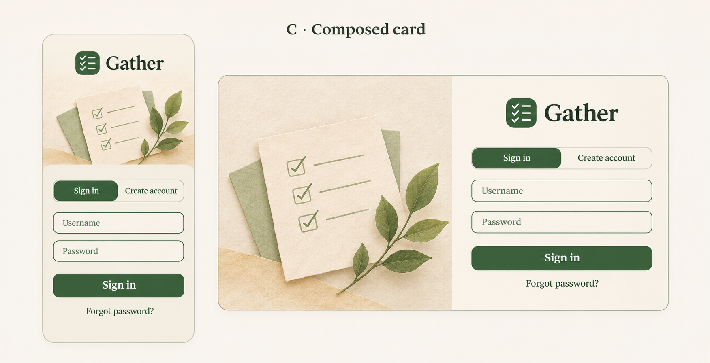

# Gather 1.1.1 design studies

Three generated directions for a fuller, minimalist sign-in screen. **C was implemented**, retaining Gather's actual logo, typography, artwork and native controls. These are design studies, not screenshots of the app.

## A — Framed

## B — Canvas

## C — Composed card

[Exact prompts and generation provenance](PROMPTS.md) · [Implemented design rationale](../../ANDROID-ADAPTIVE-DESIGN.md) · [Device and release verification](../../ANDROID-ADAPTIVE-VERIFICATION.md)

The generated studies used the built-in image-generation tool; it did not expose an Imagen model selector. The app uses the existing bundled illustration with the new composition, not a flattened mockup image.
