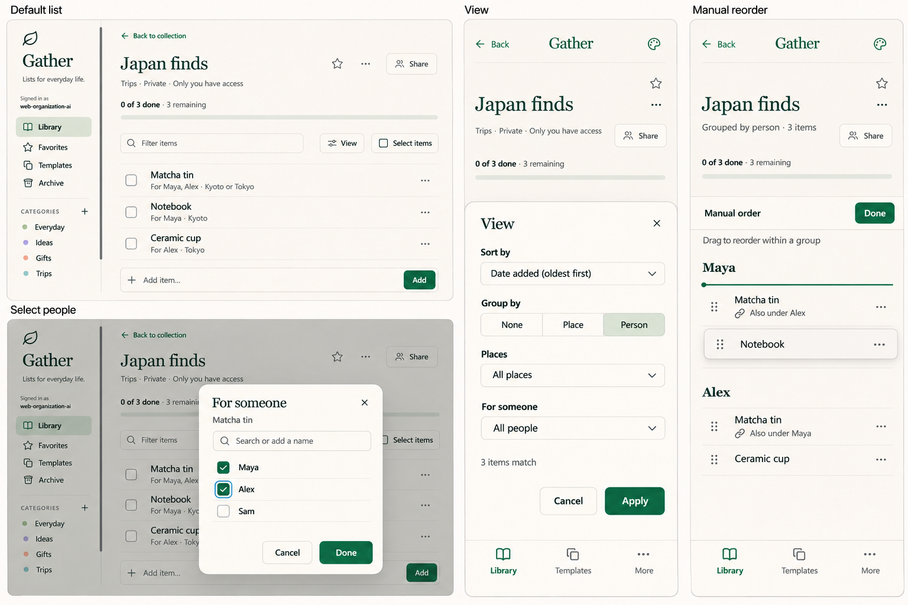
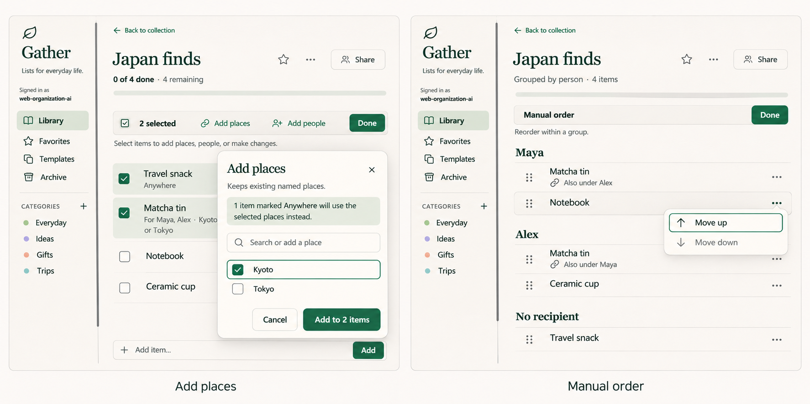

# List views design review

The review covered the single-item people picker, additive bulk edits, list views, shared item identity and manual reorder on desktop and phone. GPT-6.2 Sol (high) generated the boards with the built-in image generator using screenshots of the merged app. GPT-6.2 Astra (medium), Sol and the primary agent each inspected the results. GPT-6.1 Terra (high) handled copy and implementation testing.

A round needed an individual score of at least 8 in every category and an average of at least 8.5 **for each category** across the three reviewers.

| Round and reviewer | Visual fidelity | People picker | Bulk editing | View controls | Shared item identity | Reordering | Visual accessibility |
| --- | ---: | ---: | ---: | ---: | ---: | ---: | ---: |
| 1 · Primary | 9 | 8 | 8.5 | 9 | 9 | 7.5 | 8 |
| 1 · Sol | 9 | 9 | 8 | 9 | 9 | 8 | 8 |
| 1 · Astra | 8 | 9 | 8 | 8 | 9 | 6 | 7 |
| 2 · Primary | 9 | 9.5 | 9 | 9 | 9.5 | 9 | 8.5 |
| 2 · Sol | 9.5 | 9.5 | 9.5 | 9 | 9.5 | 9.5 | 9.5 |
| 2 · Astra | 9 | 9 | 9 | 9 | 9 | 9 | 8 |
| **2 · Mean** | **9.17** | **9.33** | **9.17** | **9.00** | **9.33** | **9.17** | **8.67** |

Round 1 failed on reorder clarity and visual accessibility. Its progress count also disagreed with its rows. The revised prompts asked for independent drag and keyboard states, a unique item total, a visible keyboard focus indicator, and explicit feedback for an item changing from Anywhere to named places.

Round 2 passed. The images below are design mockups. Their scores reflect visual inspection of both boards together.

[List views generation prompt](list-views-prompt.txt) · [Bulk editing and reorder generation prompt](bulk-and-reorder-prompt.txt)

## Working web app

Browser checks used a disposable account at desktop and 390-pixel widths. They saved and reopened a multi-person assignment, applied bulk additions, checked the Anywhere conversion message and verified the stored order after mouse and touchscreen drags.

[Desktop view settings](desktop-view.png) · [Grouped mobile list](mobile-grouped.png) · [Mobile manual reorder](mobile-reorder.png)
